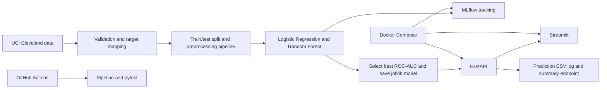

# Heart Disease Prediction with MLOps

An educational, end-to-end machine learning project that compares two models on the UCI Cleveland Heart Disease dataset, tracks training with MLflow, serves predictions through FastAPI, and provides a Streamlit interface. It runs locally on Windows and can also run with Docker Compose.

> **Medical disclaimer:** This project is for educational and research use. It is not a medical diagnostic system and must not be used to make care decisions.

## Architecture



## Features

- Downloads and validates the processed Cleveland data; maps target 0 to no disease and targets 1–4 to disease.
- Uses a stratified 80/20 split and scikit-learn pipelines so imputation, scaling, and one-hot encoding are fit on training data only.
- Compares Logistic Regression and Random Forest using accuracy, precision, recall, F1, and ROC-AUC. Selects by ROC-AUC.
- Logs both training runs, parameters, metrics, and models to local MLflow.
- Saves the selected model, feature schema, metrics, comparison table, and evaluation plots.
- Serves validated predictions through FastAPI and its `/docs` interface.
- Provides a Streamlit form, prediction CSV logging, and `/metrics` summary.
- Includes pytest tests, Docker Compose, and a GitHub Actions CI workflow.

## Technology

Python 3.11, pandas, NumPy, scikit-learn, MLflow, FastAPI, Uvicorn, Streamlit, Docker Compose, and pytest.

## Windows setup (PowerShell)

Open a terminal in this project folder:

```powershell
python -m venv .venv
.venv\Scripts\Activate.ps1
python -m pip install --upgrade pip
python -m pip install -r requirements-dev.txt
```

If PowerShell blocks activation, run `Set-ExecutionPolicy -Scope Process Bypass` in that terminal, then activate again. macOS/Linux: use `source .venv/bin/activate` after creating the environment.

## Train the models

```powershell
python scripts/run_pipeline.py
```

The first run downloads the UCI Cleveland data. It then validates the file, trains both candidates, writes their MLflow runs, chooses the best ROC-AUC, and generates local artifacts under `models/` and `reports/`.

## Start the applications

Start MLflow in one terminal:

```powershell
mlflow ui --backend-store-uri sqlite:///mlflow.db --host 127.0.0.1 --port 5000 --workers 1
```

Start FastAPI in another terminal:

```powershell
uvicorn api.main:app --reload --host 127.0.0.1 --port 8000
```

Start Streamlit in a third terminal:

```powershell
streamlit run streamlit_app/app.py
```

Open Streamlit at `http://localhost:8501`, API at `http://localhost:8000`, Swagger at `http://localhost:8000/docs`, ReDoc at `http://localhost:8000/redoc`, and MLflow at `http://localhost:5000`.

To print the local prediction summary from the terminal, run `python -m src.monitoring`.

## Test

```powershell
pytest -q
```

## Docker

With Docker Desktop running, from the project folder:

```powershell
docker compose up --build
```

Compose trains the model once, then starts FastAPI, Streamlit, and MLflow. Visit the same URLs above. Stop services with `Ctrl+C`, then optionally run `docker compose down`.

## Important outputs

| Path | Purpose |
| --- | --- |
| `models/best_model.joblib` | Selected fitted preprocessing/model pipeline |
| `models/feature_schema.json` | Feature list, version, and selection metric |
| `reports/model_comparison.csv` | Actual held-out metrics for both models |
| `reports/metrics/model_metrics.json` | Detailed metrics and selected model |
| `reports/figures/` | Confusion matrix, ROC, model comparison, feature importance |
| `reports/metrics/prediction_log.csv` | API inputs, outputs, UTC time, and model version |
| `mlflow.db` / `mlruns/` | Local MLflow experiment metadata/artifacts |

Generated model/data/tracking outputs are ignored by Git. Run the pipeline to recreate them. See `docs/` for dataset details, architecture, setup, testing, API, report, viva, and presentation notes.

## Limitations

The Cleveland dataset is small, historical, and not representative of current or all patient populations. A random split gives an educational estimate, not clinical evidence. Model probabilities are not calibrated clinical risks. Monitoring is a local CSV summary, not production observability.
