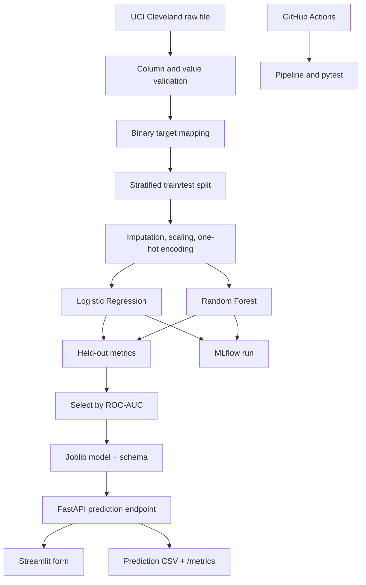

# Architecture

The saved model is the complete fitted scikit-learn pipeline, including preprocessing. The API does not refit transformations at request time. Both models use the same fixed, stratified split for a fair comparison. MLflow records an independent run for each candidate. ROC-AUC is the selection metric; the full metric set is retained for interpretation.
